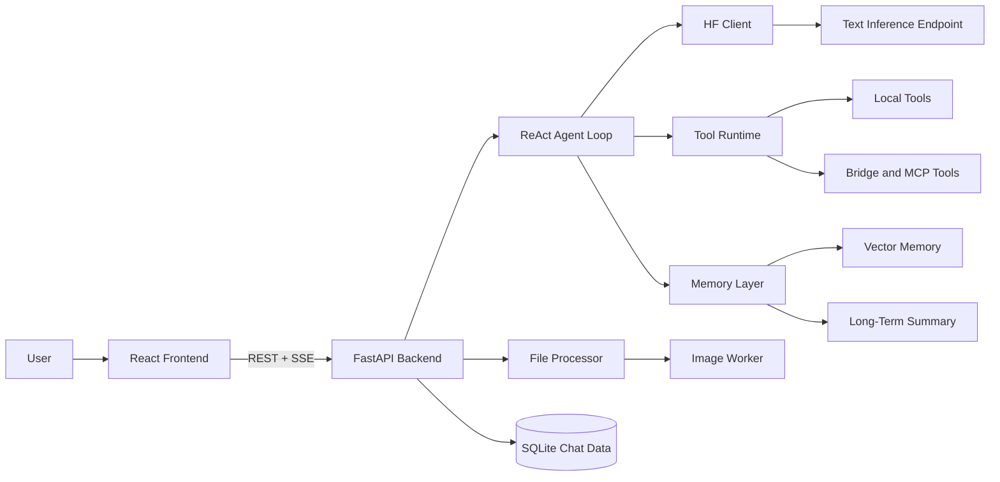
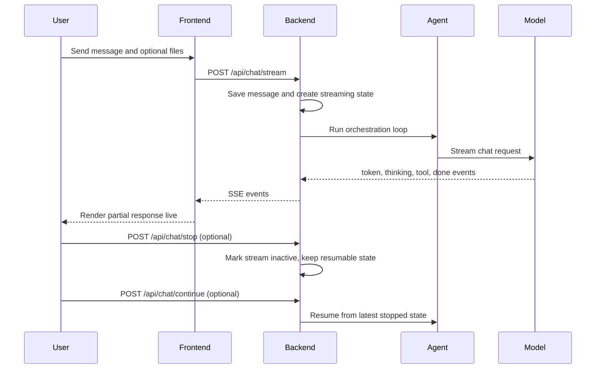

# AI Agent System

A full-stack AI agent platform with streaming chat, tool execution, persistent conversation history, workspace file management, and remote model inference.

This README is synchronized to the current codebase state and reflects what is currently implemented and working.

## Quick Start

1. Copy `.env.example` to `.env` and replace the sample worker URLs and SMTP values with your own local values.
2. Start the FastAPI backend on port `8000`.
3. Start the Vite frontend from the project root.

Backend:
```powershell
python -m venv .venv
.venv\Scripts\activate
pip install -r requirements.txt
Copy-Item .env.example .env
python -m uvicorn backend.app.main:app --reload --host 0.0.0.0 --port 8000
```

Frontend:
```powershell
npm install
npm run dev
```

## README Sync Notes

This README now includes current behavior that was missing or outdated previously:
- Added streaming lifecycle endpoints and continue flow.
- Added workspace management API endpoints.
- Corrected frontend run path (root package.json, src at project root).
- Updated active local tool list to match backend tool registry.
- Added MCP runtime behavior and dynamic tool loading details.

## High-Level Architecture

The app is built around a streaming chat loop: the React frontend sends chat requests to FastAPI, the backend coordinates model/tool execution through the agent loop, and responses stream back to the UI as SSE events.



### Chat Streaming Flow



### What Lives Where

- `src/` contains the React UI, chat state, settings UI, and workspace browser/editor.
- `backend/app/` contains the API routes, orchestration loop, file processing, and model client.
- `backend/tools/` contains local tools plus the bridge server that exposes fetch, filesystem, and shell-style tools.
- `worker.js` and `worker2.js` are optional Cloudflare inference endpoints for text and image analysis.
- `workspace/` is runtime/user content storage and is not intended to be committed to Git.

## Current Feature Set

- Streaming chat with status updates and partial token rendering.
- Stop generation and continue from saved stream state.
- Persistent conversation + message history in SQLite.
- Single-user runtime model (canonical username: GAKR).
- Chat upload processing for text, docs, data, and image formats.
- Workspace explorer with file tree, search, editor, upload, create, rename/move workflow, and delete.
- Settings dialog for SMTP credentials, inference URL, and custom instructions.
- Model health status checks.

## Project Structure

```text
app/
|- backend/
|  |- app/
|  |  |- main.py
|  |  |- core/
|  |  |  |- database.py
|  |  |  |- file_processor.py
|  |  |- memory/
|  |  |  |- vector_memory.py
|  |  |  |- long_term_memory.py
|  |  |- services/
|  |  |  |- react_loop.py
|  |  |  |- hf_client.py
|  |- hf_space/
|  |  |- app.py
|  |  |- main.py
|  |  |- server_runtime.py
|  |- tools/
|  |  |- __init__.py
|  |  |- file_ops.py
|  |  |- send_email.py
|  |  |- web_search.py
|  |  |- mcp_bridge.py
|- src/
|  |- components/
|  |- services/api.ts
|  |- store/chatStore.ts
|  |- App.tsx
|- worker.js
|- worker2.js
|- wrangler.toml
|- wrangler.worker2.toml
|- requirements.txt
|- package.json
|- start.sh
|- workspace/
```

## API Reference (Current)

### Health and Root
- GET /
- GET /api/health

### Model and Settings
- GET /api/model-status
- GET /api/settings
- POST /api/settings

### Chat and Streaming
- POST /api/chat/stream
  - multipart form fields: message, conversation_id (optional), username, files[] (optional)
- GET /api/chat/streaming-state
  - query: conversation_id, username
- POST /api/chat/stop
  - form: conversation_id, username
- POST /api/chat/continue
  - form: conversation_id, username
- POST /api/chat
  - non-streaming endpoint (testing path)

### Conversation Management
- GET /api/conversations/{username}
- POST /api/conversations
- GET /api/conversations/{username}/{conversation_id}
- PUT /api/conversations/{username}/{conversation_id}
- DELETE /api/conversations/{username}/{conversation_id}

### File Upload (Chat Context)
- POST /api/upload
  - max 5 files per request

### Tool Endpoints (Debug/Test)
- GET /api/tools
- POST /api/tools/{tool_name}

### Workspace Endpoints
- GET /api/workspace/list
- POST /api/workspace/create-file
- POST /api/workspace/create-folder
- POST /api/workspace/upload
  - max 200 files per upload
- GET /api/workspace/read-file?path=...
- POST /api/workspace/save-file
- POST /api/workspace/delete
- POST /api/workspace/rename
- POST /api/workspace/copy
- POST /api/workspace/move

## Tooling (Current Runtime)

### Always-Registered Local Tools
- send_email
- current_datetime

### Bridge-Managed Tool Families
- Fetch/search tools such as `fetch_html`, `fetch_markdown`, `fetch_txt`, `fetch_json`, `fetch_url`, `fetch_readable`, `fetch_youtube_transcript`, and `web_search`
- Filesystem tools exposed by the unified bridge server
- `run_command` shell execution inside the allowed workspace

### MCP and Bridge Notes
- The unified bridge server is the main path for fetch, filesystem, and shell capabilities.
- Extra MCP tools can be loaded from `.vscode/mcp.json` if you add that file locally.
- The repo does not require `.vscode/mcp.json` to boot; it is an optional extension point.

## File Processing Support

Supported upload extensions:
- Text/code: .txt .md .py .js .html .css .yaml .yml .xml .sql .log
- Data: .json .csv
- Documents: .pdf .docx .xlsx .xlsm .xls
- Images: .jpg .jpeg .png .webp .bmp .gif

Limits:
- Max file size: 10 MB per file
- Max extracted content length: 80,000 chars per file
- Max chat files per message: 5

Image files are described via IMAGE_WORKER_URL (Cloudflare vision worker).

## Streaming and Continuation Behavior

- Backend stores active stream state in SQLite while tokens are generated.
- /api/chat/stop deactivates active generation and keeps resumable state.
- /api/chat/continue resumes from latest stopped state in same conversation.
- Frontend handles aborts and exposes Continue when recovery is possible.

## Data and Persistence

- SQLite path: ~/.ai_agent_system/database/chatdata.db
- Key tables: users, conversations, messages, streaming_states
- Workspace root for tool and workspace operations: app/workspace
- Vector store path: workspace/vector_db
- Long-term memory file: workspace/long_term_memory.json

## Local Setup

### Prerequisites
- Python 3.9+
- Node.js 18+
- npm

### Option A: Scripted Start (Linux/macOS shell)
```bash
bash start.sh
```

### Option B: Manual Start

Backend
```bash
cd backend
python -m venv venv
# Windows: venv\Scripts\activate
# macOS/Linux: source venv/bin/activate
pip install -r ../requirements.txt
uvicorn app.main:app --host 0.0.0.0 --port 8000
```

Frontend (from project root where package.json exists)
```bash
npm install
npm run dev
```

Optional frontend env:
```env
VITE_API_URL=http://localhost:8000
```

### Windows Notes

- Use PowerShell or Command Prompt for the backend and frontend in separate terminals.
- If `Copy-Item .env.example .env` is blocked, create `.env` manually from `.env.example`.
- The backend default API URL for the frontend is `http://localhost:8000`.
- The Vite dev server usually runs on `http://localhost:5173` unless your local setup changes it.

## Deployment and Inference Backends

### Cloudflare Workers
- worker.js serves /chat and /health for text generation.
- worker2.js serves /describe (and /chat alias) and /health for image description.

Deploy commands:
```bash
wrangler deploy
wrangler deploy --config wrangler.worker2.toml
```

### Hugging Face Runtime
- backend/hf_space/server_runtime.py provides shared queue/worker streaming runtime.
- backend/hf_space/app.py targets Nanbeige/Nanbeige4.1-3B.
- backend/hf_space/main.py targets LiquidAI/LFM2.5-1.2B-Thinking.

## Environment Variables

### Core App
- HF_SPACE_URL
- HF_API_TOKEN
- CUSTOM_INSTRUCTIONS
- SMTP_HOST
- SMTP_PORT
- SMTP_USERNAME
- SMTP_PASSWORD

### File/Image Processing
- IMAGE_WORKER_URL
- IMAGE_WORKER_PROMPT
- IMAGE_WORKER_TIMEOUT_SECONDS

### Backend Logging
- BACKEND_LOG_LEVEL
- BACKEND_STREAM_LOG_PREVIEW_STEP
- BACKEND_STREAM_LOG_PREVIEW_CHARS

### Agent Runtime Context
- AGENT_TIMEZONE
- AGENT_USER_LOCATION
- AGENT_CITY
- AGENT_STATE
- AGENT_COUNTRY
- AGENT_WORKSPACE_DIR

### HF Runtime Tuning (hf_space)
- HF_MAX_WORKERS
- HF_QUEUE_MAX_SIZE
- HF_STREAMER_TIMEOUT_SECONDS
- HF_GENERATION_JOIN_TIMEOUT_SECONDS
- HF_MAX_INPUT_TOKENS
- HF_MAX_NEW_TOKENS
- HF_MODEL_LOAD_RETRIES
- HF_MODEL_LOAD_RETRY_DELAY_SECONDS
- HF_LOCAL_FILES_ONLY
- HF_DEBUG_TOKEN_LOGS

## Public Repo Safety

- `.env` is for local-only secrets; commit `.env.example`, not the real `.env`.
- The checked-in `.env.example` uses sample worker URLs and sample SMTP values on purpose.
- The root `workspace/` folder stores runtime files, uploads, and local data, so it should stay out of Git.
- Before deploying, replace sample values with your own worker endpoint URLs and SMTP credentials locally.

## Known Implementation Notes

- Username path params are currently accepted for API compatibility, but backend operates in single-user mode using GAKR as canonical user.
- SMTP host and port are treated as fixed in backend settings update flow.
- Local runtime tools are intentionally minimal; MCP expands capability dynamically.
- Think panel component exists in source, while current chat UI primarily shows thinking/status indicators inline during generation.

## Troubleshooting

### Backend does not start
1. Confirm Python version 3.9+.
2. Ensure virtual environment is active.
3. Install dependencies from requirements.txt.
4. Check that port 8000 is free.

### Frontend cannot connect
1. Confirm backend is running on expected URL.
2. Set VITE_API_URL if backend URL differs.
3. Check browser console/network for CORS or network errors.

### Model status is offline
1. Verify HF_SPACE_URL points to a live endpoint.
2. Verify Cloudflare worker/HF Space deployment health endpoint.
3. Recheck outbound internet access from backend host.

## License

MIT License
